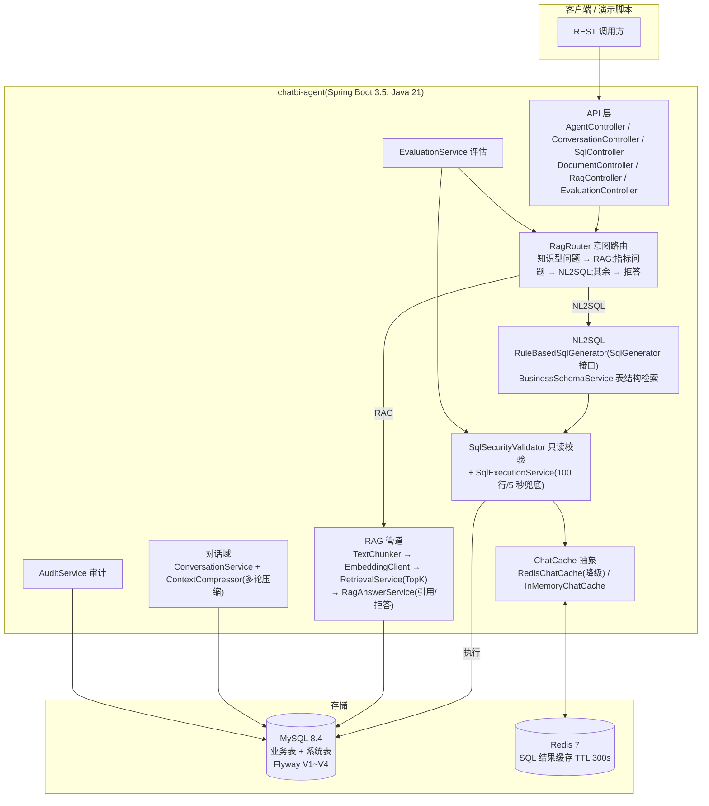
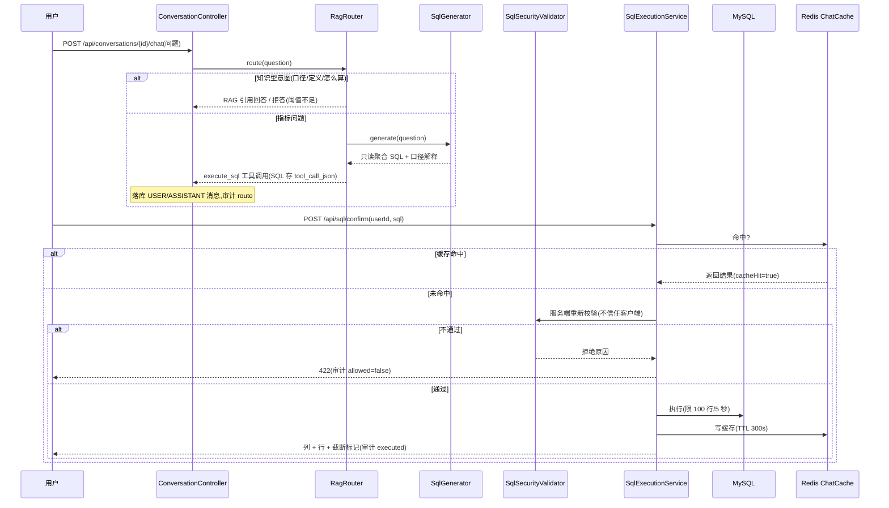
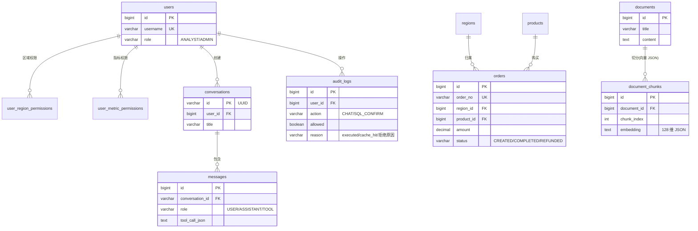

# 系统架构

> 任务:T-014(REQ-001)。本文给出总体架构、请求链路与数据模型三层视图,配合 [API 文档](api.md) 使用。

## 总体架构

## 一次问数的完整链路

## 数据模型(Flyway V1~V4)

## 关键设计决策

| 决策 | 选择 | 理由 |
| --- | --- | --- |
| NL2SQL 实现 | 规则式 `SqlGenerator` + 接口抽象 | 演示域指标有限,规则可测可解释;接 LLM 只换实现 |
| 向量存储 | MySQL TEXT 列存 JSON,应用层余弦 | 演示级语料规模,避免引入向量库依赖;检索接口已隔离,可平滑换 pgvector |
| 安全边界 | 词法校验(白名单/黑名单/敏感列)+ 执行层兜底(限行/超时) | 双层防御;宁可误拒不可放过 |
| 缓存 | ChatCache 抽象,Redis 宕机降级为未命中 | 主链路可用性优先,缓存是加速器不是依赖 |
| 评估 | 评估集入库 + 在线接口 + 离线扫参 | 准确率可量化、可复现、可回归 |
| 多轮上下文 | 阈值触发压缩:摘要 + 最近 N 条原文 | 提示词长度有界,不丢近因上下文 |

更多取舍见 `docs/adr/` 与 [实验报告](experiments/EXP-001-rag-sweep.md)。
